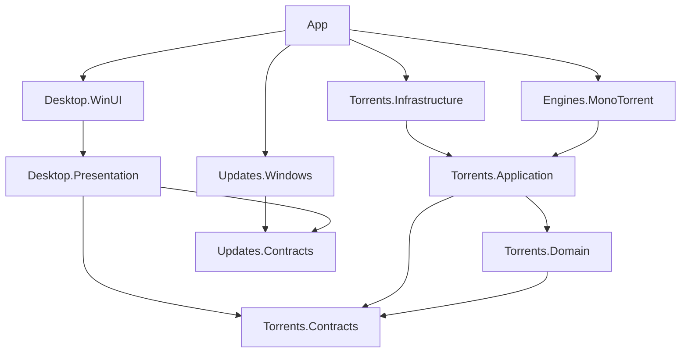

# Модульный монолит: первый этап

Дата: 2026-11-27. Реализация по разрешению владельца после согласования [ТЗ](MODULAR_MONOLITH_REQUIREMENTS.md). Этот документ заменяет прежние карты расположения кода для затронутых частей. Второй движок, новые окна и расширенные экраны в этап не входят.

## Фактическая структура

```text
src/
  NiTorrent.App/                       точка входа, host, логирование и платформенные storage-пути
  Modules/
    Torrents/
      Contracts/                      внешний интерфейс, команды, отдельные модели и наблюдение
      Domain/                         правила и модель торрент-коллекции
      Application/                    сессия, пользовательские сценарии, фасад модуля
      Infrastructure/                 каталог, настройки, host-задачи, общий сбор наблюдений, регистрация
      Engines/MonoTorrent/            отдельная сборка адаптера движка
    Desktop/
      Contracts/                      сведения о приложении, URI и настройки темы
      Presentation/                   ViewModel, локальное состояние, управление наблюдением страницы
      WinUI/                          XAML, окна, страницы, активации, трей и платформенные UI-адаптеры
    Updates/
      Contracts/                      интерфейс проверки обновлений и результат
      Windows/                        существующий адаптер DevWinUI без смены источника обновлений
tests/
  NiTorrent.Lifecycle.Tests/
  NiTorrent.Architecture.Tests/
  NiTorrent.Application.Tests/          прежняя модель, не активирован в решении
  NiTorrent.Domain.Tests/               прежняя модель, не активирован в решении
  NiTorrent.Infrastructure.Tests/       прежняя модель, не активирован в решении
```

Физически выделены 11 production-проектов. Имена существующих сборок Domain/Application/Infrastructure/Presentation и большинство пространств имён сохранены; принадлежность определяется проектом и графом зависимостей. В частности, простые транспортные типы выбора файлов и статусов с прежним пространством имён `NiTorrent.Domain.Torrents` находятся в Contracts, а изменяемая модель `TorrentDownload` остаётся внутри Domain.

Финальное упорядочение: все пять тестовых проектов перенесены из `src` в корневую папку `tests`; ссылки проектов, решения, CI и текущей документации обновлены. После переноса сборка Debug x64 завершилась без ошибок и предупреждений; из нового расположения прошли все 86 активных тестов (73 lifecycle + 13 архитектурных). Журналы: `artifacts/modular-monolith/tests-folder-build.log` и `tests-folder-tests.log`.



Это позволяет сохранить имена свойств/enum и существующий JSON-формат без отдельной миграции. Desktop не ссылается на сборку Domain, даже когда использует историческое пространство имён транспортного типа. Старые тестовые проекты прежней модели остаются файлами решения, а не активными тестовыми проектами; они не включены в заявленные результаты.

## Интерфейс и владение

- [ITorrentsModule](../../src/Modules/Torrents/Contracts/ITorrentsModule.cs): чтение отдельного снимка коллекции, предпросмотр, добавление, запуск/пауза/удаление, массовые команды и повтор. UI не получает репозиторий, `TorrentSession` или живой `TorrentDownload`.
- [ITorrentSettings](../../src/Modules/Torrents/Contracts/Settings/ITorrentSettings.cs): чтение/сохранение настроек через копии. Существующий общий файл настроек сохранён; семантикой закрытия по-прежнему владеет Desktop, параметрами движка — Torrents.
- `ITorrentsLifetime` предоставляет host только запрет новой работы при завершении. Отписка UI не вызывает остановку сессии.
- [ITorrentObservations](../../src/Modules/Torrents/Contracts/TorrentObservation.cs): явные независимые подписки с `IDisposable`, областью данных и состоянием доступности.
- App собирает модули через точки регистрации и явно выбирает `AddMonoTorrentEngine`. Infrastructure не ссылается на сборку MonoTorrent-адаптера и не выбирает движок неявно. Для headless-host необходимо зарегистрировать и `AddNiTorrentInfrastructure`, и выбранный адаптер. Окно ошибки запуска вынесено в Desktop; App согласует завершение и сообщает оболочке об ошибке.
- Реализации MonoTorrent закрыты через `internal`. Наружу сборки адаптера доступна только точка регистрации. Доступ к внутренним типам предоставлен существующим интеграционным тестам через единственный `InternalsVisibleTo`.

App продолжает предоставлять платформенные пути и marker завершения как зависимости host. Ядро запускается без Desktop и WinUI; создание окна не является владельцем движка.

## Наблюдение текущих данных

[Общий сборщик](../../src/Modules/Torrents/Infrastructure/Torrents/InMemoryTorrentRuntimeStateSource.cs) принадлежит host. Без подписчиков он ожидает запросов и не вызывает провайдер статистики. Сессия и операции движка продолжаются независимо.

Поддерживаются общие скорости, коллекция и состояние конкретного торрента. Дополнительные сведения о пирах/трекерах в первом этапе не реализованы: такой запрос получает `Unsupported` с объяснением и не включает сбор. Это ограничение текущего адаптера наблюдения, а не заявление, что сам MonoTorrent не умеет предоставлять эти данные.

- Несколько потребителей используют один последовательный сборщик; каждому доставляются полные согласованные снимки его области.
- Для одного трея используется оптимизированный запрос суммарных скоростей без построения моделей всех торрентов. Когда нужна коллекция, её общий снимок также обслуживает потребность трея.
- Последняя отписка прекращает дальнейший дополнительный сбор. Уже начатый запрос может завершиться; новые запросы для ушедших потребителей не планируются. Новая подписка пробуждает сборщик, обычная актуализация происходит примерно раз в секунду.
- [RuntimeObservation](../../src/Modules/Torrents/Infrastructure/Torrents/RuntimeObservation.cs) доставляет данные каждому потребителю последовательно. Буфер содержит только последний ожидающий снимок; медленный или ошибочный потребитель не задерживает остальных. История в этом механизме не хранится.
- При ошибке остаются последние данные с `Disconnected` и сообщением «Связь потеряна». Пока есть потребители, сборщик повторяет чтение и после успеха возвращает `Connected`. Это не повтор команд и не новый бесконечный перезапуск engine.
- Остановка отменяет доставку, закрывает подписки и ожидает исполнителей в рамках существующего срока завершения host. Обработчики должны соблюдать переданный токен отмены.

Наблюдение одного TorrentId сейчас фильтрует общий снимок адаптера. Узкий запрос к движку только по одному торренту — возможная дальнейшая оптимизация; подробные потоки по файлам/пирам в этап не включены.

## Страница и трей

[TorrentPageObservation](../../src/Modules/Desktop/Presentation/Features/Torrents/TorrentPageObservation.cs) владеет подключением страницы к [DesktopObservationLifetime](../../src/Modules/Desktop/Presentation/DesktopObservationLifetime.cs).

После успешного скрытия основного окна в трей страница освобождает подписку и сохраняет отображённую коллекцию/выбор. Трей владеет отдельной подпиской на суммарные скорости. Возврат окна подписывает активную страницу заново и обновляет данные. Обычная выгрузка страницы снимает обработчики, освобождает локальные элементы и выбор. Отмена скрытия и ошибка регистрации не объявляют видимое окно скрытым.

Настройки трея, GUID значка, ограниченный повтор регистрации, Fluent-меню, правила удаления и формат хранения сохранены. Старый интерфейс callback-подписок и неиспользуемая совместимая точка регистрации удалены после переноса потребителей; параллельного сборщика статистики нет.

## Архитектурный контроль

[NiTorrent.Architecture.Tests](../../tests/NiTorrent.Architecture.Tests/ModuleArchitectureTests.cs) проверяет:

- полный перечень production-проектов и включение их в решение;
- разрешённые ProjectReference и отсутствие циклов;
- фактические зависимости собранных сборок, включая обращения через транзитивные ссылки;
- отсутствие MonoTorrent-пакетов и ссылок на его типы за пределами адаптера;
- изоляцию Contracts от реализации, Desktop от Domain/Application/Infrastructure, Updates от реализации других модулей;
- обращение App к Infrastructure и MonoTorrent-адаптеру только через их типы регистрации;
- единственную публичную точку входа адаптера MonoTorrent и непустой анализ каждого проекта.

Используются стандартные средства .NET: `PEReader`, `System.Reflection.Metadata` и XML проектов. Сборки Windows не загружаются в CLR тестов. Корректность проверки зависимостей подтверждается изолированными IL-сборками с запрещёнными ссылками; отдельно проверяется контрольный цикл. Новая библиотека анализа не устанавливалась.

[Workflow проверок](../../.github/workflows/architecture.yml) запускается для PR и доступен как reusable workflow. [Release workflow](../../.github/workflows/release.yml) зависит от его успешного завершения. Удалённый запуск GitHub Actions и настройки required checks ветки в этой сессии не выполнялись.

## Проверки и доказательства

До изменений: 58 lifecycle-тестов прошли. Новые тесты дополняют их проверками интерфейса модуля, наблюдений и видимости страницы. Подробные журналы — `artifacts/modular-monolith/`.

| Requirement | Evidence |
| --- | --- |
| Разрешённый граф и полная регистрация модулей | `EveryProductionProjectIsRegisteredAndHasAnExplicitPolicy`, `ProjectReferencesFollowApprovedGraphWithoutCycles` |
| Реальные зависимости, закрытый движок и контроль самих правил | `CompiledModulesCannotBypassContractsThroughTransitiveReferences`, `EngineImplementationHasOnlyOnePublicRegistrationEntry`, `PolicyRejectsControlledForbiddenDependencies`, `CycleDetectorRejectsControlledCycleAndAcceptsDiamond` |
| Общий сбор и прекращение после последней отписки | `FirstObserverStartsCollectionAndLastLeaseStopsIt` |
| Отдельные области, подписка трея и возврат коллекции | `TrayOnlyUsesSummaryAndCollectionCanResumeWithCurrentData`, `TorrentScopesStayIndependentAndDisposedLeaseDoesNotReceiveNewValues` |
| Ошибка связи и автоматическое восстановление последних данных | `ConnectionFailureKeepsLastValuesAndRecoversAutomatically` |
| Медленный/ошибочный потребитель, отсутствие очереди истории | `SlowAndThrowingObserversDoNotBlockOtherConsumersOrAccumulateHistory` |
| Одновременные подписки и отмена при выходе | `ConcurrentLeasesShareOneCollectorAndShutdownCancelsDelivery` |
| Неподдерживаемые сведения и неверный запрос | `UnsupportedDetailsDoNotStartCollectionAndHaveAnExplanation`, `InvalidRequestIsRejectedBeforeStartingCollection` |
| Скрытие/возврат страницы без потери выбора и дублирования | `TrayVisibilitySuspendsPagePreservesSelectionAndResumesCurrentIntent`, `OpeningClosingAndReopeningViewModelOnlyObservesExistingSession` |
| Копии коллекции, настроек и выбора файлов; сценарии через интерфейс | `ModuleCommandsPreserveIntentAndReturnedCollectionIsDetached`, `SettingsQueriesAndSavedInputCannotMutateModuleStateByAliasing`, `PreviewAndAddKeepSelectionDetachedAndDetectDuplicatesBeforeEngineStartup` |
| Работа без UI и реальный MonoTorrent с обоими режимами удаления | `HeadlessHostRestoresWithoutObserversAndAllowsLateSubscription`, `RealEngineRestoresWithoutUiAndHonorsDeleteFiles` |

Итоговые результаты последней реализации:

| Проверка | Результат | Артефакты |
| --- | --- | --- |
| Полная сборка решения managed x64 Debug с `--no-incremental` | 0 ошибок, 3 прежних nullable-предупреждения | `artifacts/modular-monolith/verified-debug-build.log` |
| Полная сборка решения managed x64 Release с `--no-incremental` | 0 ошибок, те же 3 предупреждения | `artifacts/modular-monolith/verified-release-build.log` |
| Тесты решения Debug | Lifecycle 73 passed, Architecture 13 passed; 0 failed, 0 skipped | `verified-debug-tests.log`, отдельные TRX в `artifacts/modular-monolith/verified-debug/` |
| Тесты решения Release | Lifecycle 73 passed, Architecture 13 passed; 0 failed, 0 skipped | `verified-release-tests.log`, отдельные TRX в `artifacts/modular-monolith/verified-release/` |
| Обнаружение тестов через решение | Найдены все 86 тестов | `artifacts/modular-monolith/discovery.log` |
| Изолированный инструмент замеров после обновления ссылок на исходники | Сборка успешна, 0 ошибок/предупреждений; измерения не запускались | `tools/startup-baseline/StartupBaseline.csproj` |

TRX проверены по счётчикам и результатам каждого теста. Архитектурный и lifecycle-наборы хранятся в отдельных файлах; промежуточный прогон с одинаковым `LogFileName` перезаписывал отчёт и не используется как итоговый артефакт.

Команды для воспроизведения managed x64:

```powershell
dotnet build NiTorrent.slnx --no-incremental -p:Platform=x64 -p:WindowsPackageType=None -p:PublishAot=false -p:PublishTrimmed=false -p:PublishReadyToRun=false -v minimal
dotnet test NiTorrent.slnx --no-build --no-restore -p:Platform=x64 -p:WindowsPackageType=None -p:PublishAot=false -p:PublishTrimmed=false -p:PublishReadyToRun=false --logger trx --results-directory artifacts/modular-monolith/verification -v minimal
```

Для Release добавить `-c Release` в обе команды. Архитектурные тесты можно запускать отдельно через их csproj; он предварительно собирает приложение как вход анализа. Остальные тесты запускаются через `tests/NiTorrent.Lifecycle.Tests/NiTorrent.Lifecycle.Tests.csproj`.

Проверки UI используют существующий `artifacts/tray-comparison/ui-fluent-smoke.ps1`, временный `NITORRENT_DATA_ROOT`, синтетический торрент и отключённый discovery. Запуск внутри песочницы завершился отказом регистрации нативного значка; резервный сценарий сохранения доступного окна и выхода прошёл. Вне песочницы итоговые Debug и Release прошли полный сценарий меню, Escape, паузы/продолжения с проверкой каталога, возврата окна, повторного входа в трей и выхода с кодом 0; у обоих профилей подтверждён `State=Clean`. Это отдельный результат от изоляционных unit/integration-тестов подписок.

Итоговые UI-журналы: `artifacts/modular-monolith/verified-debug-ui.log`, `verified-release-ui.log`. Профили и снимки меню:

- Debug: `artifacts/startup-baseline/ui-Debug-20261126T214021492Z/`.
- Release: `artifacts/startup-baseline/ui-Release-20261126T214122890Z/`.

Имена каталогов содержат UTC-время; в часовом поясе владельца эти проверки выполнены 27 ноября.

## Ограничения

- Второй движок, сеть внешнего backend и миграция его состояния не реализованы; выбор кандидата требует отдельного исследования.
- Сборки проверки — managed x64, без AOT, trimming и ReadyToRun. MSIX-публикация, AOT и остальные архитектуры процессора не подтверждены этими результатами.
- Полноценная сеть BitTorrent и производительность на больших коллекциях в этом этапе не измерялись. Ускорение запуска не заявляется.
- Существующие nullable-предупреждения не являются предметом переноса.
