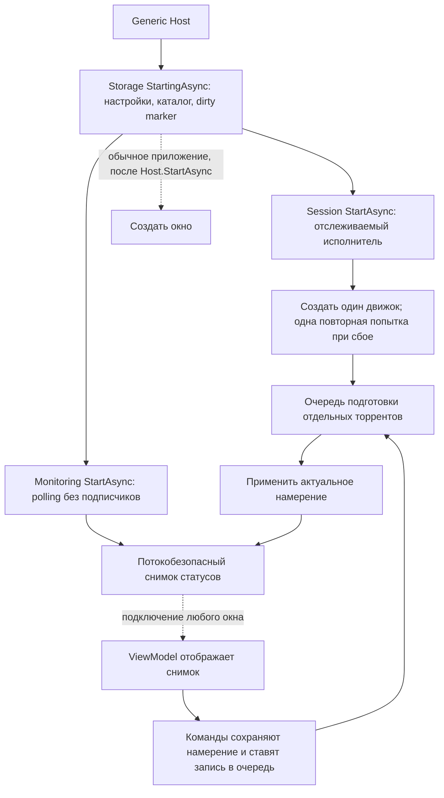

# Самостоятельное ядро NiTorrent

<!-- documentation-status-2026-11-27 -->
> Датированный отчёт/исследование предыдущего этапа. Наблюдения, команды и ограничения ниже относятся к его дате. Текущая карта, подписки и тесты — [в отчёте модульного монолита](MODULAR_MONOLITH_IMPLEMENTED_2026-11-27.md); рабочие инструкции — [в README](README.md).

Обновление 2026-11-27: код перенесён в модули; наблюдение UI теперь включается по подпискам. Актуальная структура и проверки — [первый этап модульного монолита](MODULAR_MONOLITH_IMPLEMENTED_2026-11-27.md). Ниже сохранено описание и результаты этапа от 24 ноября; постоянный polling без потребителей больше не является текущим требованием.

Первый этап реализован 24 ноября 2026 года. Этот документ описывает новый порядок; [STARTUP_CALL_PIPELINE.md](STARTUP_CALL_PIPELINE.md) остаётся историческим снимком до изменений.

## Владение и порядок

`AddNiTorrentInfrastructure` регистрирует ядро без WinUI и Presentation. Его можно запустить обычным Generic Host без окон, dispatcher и ViewModel. Конструкторы не запускают движок и не читают настройки; загрузка настроек выполняется лениво в явной фазе подготовки.

Стрелки от S к R и M показывают доступность хранилища; host последовательно вызывает короткие StartAsync, а сами рабочие задачи выполняются независимо. `ApplicationStarted` не означает окончания восстановления. Режим запуска только в трее ещё не добавлен; возможность работы ядра без UI проверена интеграционно.

| Модуль | Ответственность |
| --- | --- |
| `StorageHostedService` | Загрузка настроек и каталога; финальное сохранение и clean marker |
| `TorrentSession` / `TorrentSessionHostedService` | Намерения, очередь, подготовка отдельных записей, отмена и отслеживание операций с движком |
| `TorrentEngineLifecycle` | Создание, остановка и освобождение конкретного MonoTorrent engine |
| `InMemoryTorrentRuntimeStateSource` | Polling под управлением host; снимки и уведомления, не зависящие от числа подписчиков |
| `NiTorrentApplication` | Активации Windows, открытие оболочки, запрос остановки host и выход из WinUI |
| ViewModel | Чтение коллекции и снимков, команды, UI-диспетчеризация; не запускает восстановление |

Старый `AppLifecycleCoordinator`, UI-контекст lifecycle и задачи с числовыми стадиями удалены. `RestoreSessionUseCase` оставлен для существующего изолированного инструмента замеров, но не зарегистрирован и не используется рабочим startup.

## Работа с торрентами

- Start/Pause сначала сохраняют пользовательское намерение. Единственный исполнитель перечитывает его после создания менеджера и перед передачей, чтобы не восстановить старый Running поверх новой паузы.
- Пользовательские действия повышают приоритет записи. После четырёх приоритетных обработок выполняется одна обычная; выполняющийся вызов движка не прерывается ради смены приоритета.
- Сбой одной записи фиксируется отдельно; остальные продолжаются. «Повторить» переиспользует обычную подготовку одной записи и очищает частично созданный менеджер. Кнопка показана для ошибки конкретного торрента; общий сбой движка сообщается отдельно.
- Удаление без файлов не требует создания менеджера. Удаление с файлами сохраняет `Status=Deleted` и дополнительный `DeleteFiles=true`, показывает «Удаление» и выполняет удаление через `RemoveMode.CacheDataAndDownloadedData`. До успеха запись остаётся доступной для повтора.
- Отложенное удаление переживает штатный выход и перезапуск. Создание менеджера для удаления не запускает передачу.
- Получение magnet metadata и применение настроек движка отслеживаются сессией, отменяются при остановке и завершаются до освобождения engine. Конструктор metadata provider не обращается к ещё не созданному engine.
- Для старой записи, содержащей только magnet без доступных metadata в кэше, подготовка завершается локальной ошибкой: нельзя молча пропустить сохранённый выбор файлов и начать скачивание всего. Новое добавление magnet уже сохраняет полученные bytes metadata; дальнейший механизм восстановления старого источника относится к следующему этапу.
- Позднее открытие страницы загружает актуальную коллекцию и снимок. Закрытие страницы снимает только подписки; polling и runtime продолжаются.

## Хранение и завершение

Формат каталога сохранён, `DeleteFiles` по умолчанию false для старых записей. Исходники по-прежнему хранятся в прежнем формате; новая папка источников относится к следующему этапу.

Каталог и настройки записываются полным снимком во временный файл с последующей заменой. При ошибке обычного сохранения актуальные данные остаются в памяти и ожидают следующей записи. Финальный flush сообщает об ошибке, чтобы не записать ложный clean marker. Копия `.torrent` удаляется только после успешной записи каталога без соответствующей записи. Последние изменения могут потеряться, если процесс завершится до успешного сохранения.

Exit запрещает новые команды, отменяет startup и операции сессии, закрывает оболочку и останавливает host. `StoppingAsync` запрашивает отмену. В обратном порядке StopAsync завершаются мониторинг, исполнитель и операции движка, сам движок и сохранение. Общий срок ожидания — 10 секунд; после незавершённой остановки clean marker не гарантируется. До выхода не требуется восстанавливать всю коллекцию.

## Проверки

Новый xUnit-проект `NiTorrent.Lifecycle.Tests` включён в `NiTorrent.slnx` как Project. Старые тесты прежней модели остаются без изменений и не входят в заявленный результат новой проверки.

| Requirement | Evidence |
| --- | --- |
| Ядро без UI и polling без подписчиков | `HeadlessHostRestoresPollsWithoutSubscribersAndAllowsLateSubscription` |
| Разрешение DI не создаёт engine и не читает хранилище | `ResolvingCoreAndMetadataDoesNotReadStorageOrCreateEngine` |
| Позднее и повторное открытие ViewModel | `OpeningClosingAndReopeningViewModelOnlyObservesExistingSession` |
| Пауза во время Add и последнее раннее намерение | `PauseAcceptedDuringAddPreventsRestoredRunningIntentFromStarting`, `LatestOfSeveralEarlyCommandsIsAppliedOnceEngineIsReady` |
| Подтверждённое добавление до engine и запрет после остановки | `ConfirmedAddBeforeEngineStartupIsPersistedAndRestored` |
| Изоляция ошибки и локальный повтор | `FailedTorrentDoesNotBlockOthersAndRetryCleansPartialManager`, `InvalidSourceIsIsolatedToOneTorrentDuringRestore` |
| Приоритет и отсутствие голодания обычной очереди | `PriorityQueueServesNormalWorkAfterFourUserRequests` |
| Удаление без engine, гонка с Add и продолжение после reload | `DeleteWithoutFilesDoesNotRequireStartingEngine`, `DeleteDuringAddDoesNotResurrectOrStartTorrent`, `PendingDeleteWithFilesSurvivesReloadAndNeverStartsTransmission` |
| Реальный MonoTorrent и оба режима удаления, включая заблокированный файл и повтор | `RealEngineRestoresWithoutUiAndHonorsDeleteFiles` — три набора параметров |
| Запрет передачи до безопасного применения выбора файлов | `MissingMagnetMetadataCannotStartTransferWithoutApplyingFileSelection` |
| Ограниченный повтор engine и общая ошибка при пустой коллекции | `EngineStartupHasOneRetryAndKeepsIntentOnPermanentFailure`, `EngineFailureIsPublishedWithoutAnyTorrentsOrStatusSubscribers` |
| Отмена startup, Add, metadata и честный clean marker | `ShutdownCancelsEnginePreparationWithoutRetrying`, `ShutdownCancelsInFlightAddAndNeverBeginsNextTorrent`, `ShutdownCancelsAndDrainsMetadataOperations`, `FailedEngineStopDoesNotWriteCleanShutdownMarker` |
| Завершение принятой команды до освобождения ресурсов хранения | `ShutdownDrainsAdmittedCommandBeforePersistenceResourcesAreReleased` |
| Сбой записи и следующая запись полного состояния | `FailedWriteRetainsLatestFullSnapshotAndPreservesPreviousFile`, `SettingsSaveRetriesAfterFailureAndRemainsReadableByExistingLoader` |
| Старый каталог и защита источника/повреждённого файла | `LegacyCatalogWithoutDeleteFlagKeepsStatusSourceAndFileSelection`, `SourceCopyIsKeptUntilCatalogDeletionIsDurable`, `CorruptCatalogIsNotOverwrittenByLoadOrFlush` |

Финальные полные сборки Debug/Release managed x64 прошли без ошибок; в каждой остались 8 предупреждений nullable/XAML/WinRT/trimming из существующего кода. В обеих конфигурациях выполнено по 29 тестов: 29 passed, 0 failed, 0 skipped. AOT и trimming при этих сборках выключены; результаты не подтверждают AOT-публикацию. Отчёты TRX и build logs находятся в `artifacts/startup-baseline`.

## Проверка настоящего окна и ограничения

Debug и Release запускались без отладчика на отдельном профиле: один синтетический приостановленный торрент, один файл, сетевой discovery выключен. Окно обнаружено; отправлен обычный WM_CLOSE; процессы завершились с кодом 0 и clean marker. Изолированный профиль выбирается диагностической переменной `NITORRENT_DATA_ROOT`; без неё используются прежние пути.

Наблюдаемые времена обнаружения видимого окна: около 5,61 с Debug и 7,76 с Release. Это по одному прогону с неконтролируемым кэшем и другой коллекцией; они **не доказывают ускорение** относительно реального профиля. Время первого отрисованного кадра отдельно не измерялось. Для следующего этапа производительности нужны сопоставимые серии на одном профиле.

Обнаружено ограничение текущей среды/WinUIEx: создание `TrayIcon` выбрасывает `NotImplementedException: SetShownInSwitchers failed`. Ошибка изолирована от ядра: окно остаётся доступным, активации обрабатываются, повторное создание неисправного трея не выполняется. Вместо скрытия в недоступный трей предусмотрена минимизация в панель задач. Работа самого значка и его меню в этой среде не подтверждена; обновление библиотек в этап не входило.

Системное открытие файла сохранено в коде, но интеграция с установленными файловыми ассоциациями отдельно не проверялась. Новый предпросмотр и восстановление через источник не реализованы в этом этапе.
