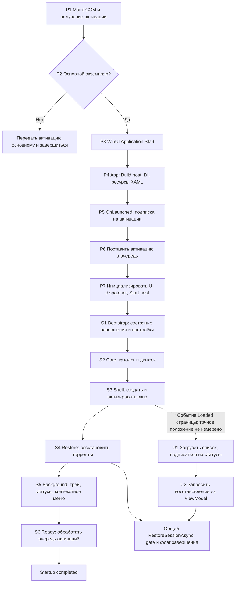

# Порядок вызовов запуска NiTorrent

<!-- documentation-status-2026-11-27 -->
> Датированный отчёт/исследование предыдущего этапа. Наблюдения, команды и ограничения ниже относятся к его дате. Текущая карта, подписки и тесты — [в отчёте модульного монолита](MODULAR_MONOLITH_IMPLEMENTED_2026-11-27.md); рабочие инструкции — [в README](README.md).

Исторический снимок до переработки. После реализации первого этапа актуальный порядок находится в [RUNTIME_LIFECYCLE_IMPLEMENTED.md](RUNTIME_LIFECYCLE_IMPLEMENTED.md). Удалённые исходники прежнего lifecycle доступны в коммите `265f29b`.

Состояние кода на 24 ноября 2026 года, коммит `265f29b`. Это текущий порядок для обсуждения перестановок. Изменений логики приложения по этой схеме ещё нет.

Времена взяты из обычного запуска Debug x64 в 20:58:19–20:58:23 по Москве. Ноль — запись `Process start` в `Program.Main`, а не создание процесса операционной системой. `Shell shown` записывается после вызова `Activate()` и не подтверждает первый отрисованный кадр. Готовность списка и команд отдельными маркерами пока не измерена.

## Общая схема



Сплошные стрелки — ожидаемый порядок основной цепочки. Пунктир — событийная ветка UI: она может пересекаться по времени с основной цепочкой. Схема не задаёт отдельные фоновые потоки.

## Что происходит до lifecycle

| ID | Вызовы по порядку | Что важно для перестановки |
| --- | --- | --- |
| P1 | `Program.Main` → ранний лог → `InitializeComWrappers` → `GetActivatedEventArgs` | Получаем COM/WinRT окружение и причину запуска |
| P2 | `FindOrRegisterForKey("NiTorrent")` → проверка `IsCurrent` | Второй процесс перенаправляет активацию и выходит; тяжёлый запуск ему не нужен |
| P3 | `Application.Start` → установка `DispatcherQueueSynchronizationContext` → `new App()` | Начало WinUI и работа с UI-потоком |
| P4 | `Host.CreateDefaultBuilder` → `ConfigureServices` → `Build` → сохранить `Services` → создать `NiTorrentApplication` → настроить `AppShutdownService` → `App.InitializeComponent` | Последний вызов загружает ресурсы App.xaml. Регистрации DI и создание объектов — разные события |
| P5 | `App.OnLaunched` → подписка `AppInstance.Activated` → `NiTorrentApplication.StartAsync` | Последующие открытия файлов попадают в тот же экземпляр |
| P6 | Лог активации → `ActivationQueue.Enqueue` → `EnsureStartupStarted` | `_startupTask` под lock обеспечивает один запуск основной цепочки |
| P7 | `StartCoreAsync` → `UiDispatcherHolder.Initialize` → `_host.StartAsync` → получить `AppLifecycleCoordinator` → создать контекст → `StartAsync` | Dispatcher должен существовать до разрешения зависящих от него объектов |

При `ConfigureServices` создаётся `AppStorageService`, вычисляется путь журнала, создаётся `FileLoggerProvider`. Фабрика `AppJsonSettings` выполняет `JsonSettings.Load` при разрешении этой зависимости, а не при регистрации. Поэтому чтение настроек частично происходит раньше задачи `Load app settings`.

Во время `Host.StartAsync` разрешается hosted service `AppHostLifecycleService`, который зависит от `AppLifecycleCoordinator`. Координатор получает и материализует весь `IEnumerable<IAppLifecycleTask>`. **Конструкторы задач и их зависимостей выполняются до первого этапа**, даже если сама задача назначена в `Background` или `Ready`. Перенос `Stage` сам по себе не откладывает конструктор.

`AppHostLifecycleService.StartAsync` ничего не запускает. Основную последовательность запуска явно вызывает `NiTorrentApplication.StartCoreAsync` после старта host.

## Последовательность задач lifecycle

Координатор сортирует задачи по `Stage`, затем `Order`, и последовательно ожидает `StartAsync` каждой задачи. Для одинаковых `Stage` и `Order` сохраняется порядок входного перечисления. Задачи с пустым Start нужны для регистрации действий завершения.

| ID | Stage / Order | Задача и вложенные вызовы | Время в обычном запуске |
| --- | --- | --- | ---: |
| S1a | Bootstrap / 0 | `ReadPreviousStateAsync` → записать предыдущее состояние в контекст → `MarkStartedAsync` | 89 мс |
| S1b | Bootstrap / 100 | `Flush settings repository`: Start пустой | 1 мс |
| S1c | Bootstrap / 999 | `AppSettingsService.InitializeAsync` → `SettingsRepository.GetAsync` → `Current = ...` → `Changed` | 98 мс |
| S2a | Core / 100 | `JsonTorrentRepository.LoadingAsync`: прочитать каталог торрентов | 79 мс |
| S2b | Core / 200 | `TorrentEngineLifecycle.StartAsync` → `EngineSettingsService.InitializeAsync` → сформировать настройки/каталог кэша → `TorrentEngineCoordinator.InitializeAsync` → `new ClientEngine` | 6 мс |
| S2c | Core / 300 | `Flush torrent runtime state`: Start пустой | 1 мс |
| S3 | Shell / 0 | `MainWindowLifecycle.StartAsync` → поставить работу в UI dispatcher → создать/настроить окно → `Activate` | 700 мс |
| S4 | Restore / 0 | `RestoreSessionLifecycleTask` → общий `TorrentEngineLifecycle.RestoreSessionAsync` → `RestoreSessionUseCase` | 804 мс |
| S5a | Background / 100 | `StartTrayAsync` → UI dispatcher → `EnsureTrayInitialized` → создание трея и подписки | 56 мс |
| S5b | Background / 1000 | `InMemoryTorrentRuntimeStateSource.StartAsync`: пустой, polling запускает подписка UI | 1 мс |
| S5c | Background / 1000 | `ContextMenuStartupTask`: для packaged-варианта `ContextMenuService.SaveAsync`, для unpackaged выход | 2 мс |
| S6a | Ready / 0 | `ReadyForActivationLifecycleTask` → `ActivationQueue.DrainAsync` → `IAppActivationService.HandleAsync` для каждого события | 11 мс |
| S6b | Ready / 800 | `Stop torrent runtime work`: Start пустой | 1 мс |
| S6c | Ready / 900 | `Stop accepting torrent work`: Start пустой | 1 мс |

После S6: `context.MarkStarted()` и запись `Startup completed`. Это не отдельная проверка готовности каждого элемента интерфейса или сетевого соединения.

## Создание окна и событийная ветка страницы

Внутри S3 выполняется следующий порядок:

```text
UI dispatcher
  MainWindowLifecycle.CreateAndInitialize
    взять CloseBehavior из загруженных настроек
    подписаться на изменение настроек
    new MainWindow
      получить MainViewModel из DI
      MainWindow.InitializeComponent
      настроить заголовок
      получить JsonNavigationService
      Initialize навигации
      ConfigureDefaultPage(TorrentPage)
      ConfigureSettingsPage(SettingsPage)
      ConfigureJsonFile, TitleBar, BreadcrumbBar
    установить название окна и иконку
    подписаться на AppWindow.Closing
    ThemeService.Initialize(window)
    записать Shell created
  Activate
  записать Shell shown
```

Когда навигация создаёт `TorrentPage`, её конструктор получает `TorrentViewModel`, загружает XAML и подписывается на `Loaded`/`Unloaded`. Точный момент создания страницы внутри навигации требует отдельного маркера.

```text
U1 TorrentPage.Loaded
  ViewModel.TorrentLoading (Task вызывается без await в OnLoaded)
    дождаться _startupGate
    если список уже заполнен: обновить сводку и выйти
    GetTorrentListQuery.ExecuteAsync
    создать TorrentItemViewModel для каждой записи
    заполнить ObservableCollection
    обновить сводку
    подписаться на runtime-статусы
      первый подписчик запускает polling
U2  await TorrentEngineLifecycle.RestoreSessionAsync
    освободить _startupGate
```

Таким образом, polling может начаться из подписки UI ещё до задачи S5b. А S4 и U2 запрашивают одно восстановление: `_restoreGate` сериализует обращения, `_restoreStarted` после успешного завершения не даёт повторять работу. Если восстановление завершилось ошибкой, флаг успеха не установлен и следующий вызов может повторить попытку. Какая ветка вошла первой в этом запуске, текущий лог не показывает.

## Восстановление одного торрента

```text
RestoreSessionAsync
  проверить флаг, войти в _restoreGate, повторно проверить флаг
  RestoreSessionUseCase.ExecuteAsync
    repository.GetAllForRestoreAsync
    для каждой записи последовательно:
      gateway.ExistsByIdAsync
      если уже существует: перейти к следующей записи
      gateway.AddAsync
      gateway.UpdateFileSelectionAsync
      если сохранённый статус Running: gateway.StartAsync
      Task.Delay(5)
  отметить успешное завершение всего восстановления
  освободить _restoreGate
```

При исключении последовательность use case прерывается. Проверка существующих Id помогает повторному вызову пропускать добавленные менеджеры, но сама по себе не доказывает, что частично добавленному менеджеру уже применены выбор файлов и запуск.

## Неявная ветка создания движка

```text
Разрешение задач DI
  создание EngineSettingsService
    подписка на AppSettingsService.Changed

S1c загрузка настроек
  Changed(Current)
    EngineSettingsService.OnUpdateSettings
      ApplySettingsAsync (возвращаемая Task не ожидается)
        если движка нет: new ClientEngine

S2b штатный запуск
  EngineSettingsService.InitializeAsync
    TorrentEngineCoordinator.InitializeAsync
      new ClientEngine без проверки существующего
```

По текущему графу зависимостей есть путь к созданию движка на S1c и его замене на S2b без освобождения предыдущего экземпляра в `InitializeAsync`. Число фактических созданий в измеренном запуске не записывалось. До изменения порядка нужно устранить неоднозначность владельца инициализации; простое перемещение S2b не исключает раннюю работу по событию `Changed`.

## Временная шкала обычного запуска

| Маркер | Время от первой записи Main |
| --- | ---: |
| `Process start` | 0 |
| Основной экземпляр определён | 0,121 с |
| Вход в `NiTorrentApplication.StartAsync`, запись активации | 1,145 с |
| Host start requested | 1,156 с |
| Host start completed | 1,336 с |
| Bootstrap started | 1,344 с |
| Shell started | 1,633 с |
| Shell created | 2,274 с |
| Shell shown | 2,334 с |
| Restore stage completed | 3,144 с |
| Startup completed | 3,246 с |

Интервал между определением экземпляра и входом в `NiTorrentApplication.StartAsync` занимает около 1,024 с. В нём находятся запуск WinUI, конструктор App, построение host, ресурсы XAML и путь до OnLaunched; отдельного распределения времени между ними пока нет. Значения этапов нельзя складывать с уже включающими их накопленными отметками.

## Ограничения и последствия перестановок

Это условия для оценки будущего предложения. Они не требуют сохранить весь сегодняшний порядок.

| Что переносим | Условия и возможные последствия |
| --- | --- |
| Окно раньше настроек | Сейчас тема и поведение закрытия берутся из настроек. Возможны смена темы после показа и неверная обработка раннего X; нужен определённый временный режим |
| Окно раньше чтения каталога | Можно показать оболочку, но список должен иметь состояние загрузки. Текущая загрузка страницы не должна принять незагруженный каталог за пустой |
| Движок после окна | Нужно убрать раннее создание по Changed и определить поведение Start/Add/Pause до готовности. Сейчас DI и ViewModel связаны с runtime-контрактами |
| Восстановление отдельно от показа списка | Список и движок уже имеют разные пути, но два инициатора restore мешают управлять моментом старта. Нужно одно место, владеющее запуском и отменой |
| Восстановление параллельно по торрентам | Текущий общий gate сериализует целое восстановление, но не обеспечивает безопасность параллельных Add/Start внутри него. Нужны предел параллелизма, проверка хранилищ/движка, обработка частичных ошибок и выход во время работы |
| Трей раньше восстановления | Возможно при готовом UI dispatcher и shell. Нужно проверить X, скрытие и Exit во время startup: сейчас shutdown сначала ждёт startup |
| Обработка активаций раньше восстановления | Открытие файла/magnet может пересечься с восстановлением той же записи и командами пользователя. Нужны правила дедупликации и готовности движка |
| Мониторинг статусов позже | Окно может показывать устаревшие скорости/состояния; нужно управлять ранней подпиской UI, которая сама запускает polling |
| Ресурсы или части UI позже | Создание WinUI-объектов остаётся на UI-потоке. Нужные первому экрану ресурсы должны быть доступны; сложные панели можно создавать отдельно после измерений |
| Запись логов через очередь | Снижает синхронную работу вызывающего потока, но нужны порядок сообщений, ограничение очереди и flush на выходе |

`async` и `ConfigureAwait(false)` не означают автоматический перенос работы в ThreadPool. Синхронная часть метода выполняется на вызывающем потоке до незавершённого await. Окно, XAML и обновления ObservableCollection требуют корректной UI-диспетчеризации.

## Завершение приложения

Порядок завершения тоже ограничивает возможное распараллеливание запуска:

```text
ShutdownAsync, защита от повторного входа
  ждать _startupTask с таймаутом
  прекратить приём активаций
  прекратить приём торрент-команд
  сохранить настройки через FlushAsync
  скрыть shell, остановить трей
  lifecycleCoordinator.StopAsync для успешно начатых задач:
    100  Stop accepting torrent work
    200  Flush settings repository
    300  Close shell
    400  Stop tray
    410  Context menu: Stop пустой
    420  Stop runtime state source / polling
    500  Stop torrent runtime: последовательно manager.StopAsync(3 секунды)
    600  Flush repository, DisposeRuntime
    остальные: обратный порядок старта, Stop в текущих задачах пустой
  host.StopAsync: hosted service повторно вызывает StopAsync,
    защита координатора предотвращает повторную последовательность
  записать clean shutdown marker
  Dispose host
  Exit через UI dispatcher
```

Три секунды передаются в `manager.StopAsync` как параметр. Совпадение этого значения с измеренными 3,05 с остановки не доказывает, что весь интервал — искусственное ожидание; нужна проверка поведения менеджера. Отдельные шаги имеют внешние таймауты. Если ожидание startup истечёт, shutdown может продолжиться, пока startup ещё выполняется; перестановки должны учитывать эту гонку.

## Как предложить новый порядок

Можно ссылаться на ID из таблиц. Например:

```text
До окна: P1–P7, S1c
Показать: S3
После показа: S2a, S2b
Параллельно с восстановлением: S5a
Отдельно решить: когда разрешать U1, U2 и S6a
Желаемое поведение: что уже видно и какие команды работают на каждом шаге
При X или Exit во время загрузки: ожидаемый результат
```

Это пример формы предложения, а не проверенная реализация. Для любого порядка нужно оценить четыре отдельных результата: активацию окна, первый кадр, заполнение списка и готовность команд. Затем проверить зависимости, поток UI, повторные вызовы, ошибки и завершение во время запуска.

## Исходники

- [Program](../../src/NiTorrent.App/Program.cs), [App](../../src/NiTorrent.App/App.xaml.cs), [App.xaml](../../src/NiTorrent.App/App.xaml).
- [NiTorrentApplication](../../src/NiTorrent.App/Services/AppLifecycle/NiTorrentApplication.cs), `AppHostLifecycleService` (исторический путь: `../../src/NiTorrent.App/Services/AppLifecycle/AppHostLifecycleService.cs`), `координатор` (исторический путь: `../../src/NiTorrent.Application/AppLifecycleCoordinator.cs`).
- [MainWindowLifecycle](../../src/Modules/Desktop/WinUI/Services/AppLifecycle/MainWindowLifecycle.cs), [MainWindow](../../src/Modules/Desktop/WinUI/MainWindow.xaml.cs), [TorrentPage](../../src/Modules/Desktop/WinUI/Views/Torrents/TorrentPage.xaml.cs), [TorrentViewModel](../../src/Modules/Desktop/Presentation/Features/Torrents/TorrentViewModel.cs).
- [RestoreSessionUseCase](../../src/Modules/Torrents/Application/Torrents/UseCase/RestoreSessionUseCase.cs), [TorrentEngineLifecycle](../../src/Modules/Torrents/Engines/MonoTorrent/TorrentEngineLifecycle.cs), [EngineSettingsService](../../src/Modules/Torrents/Engines/MonoTorrent/EngineSettingsService.cs), [TorrentEngineCoordinator](../../src/Modules/Torrents/Engines/MonoTorrent/TorrentEngineCoordinator.cs).
- [DI Infrastructure](../../src/Modules/Torrents/Infrastructure/DI/DependencyInjection.cs), [источник статусов](../../src/Modules/Torrents/Infrastructure/Torrents/InMemoryTorrentRuntimeStateSource.cs), [очередь активаций](../../src/Modules/Desktop/WinUI/Services/AppLifecycle/ActivationQueue.cs).
