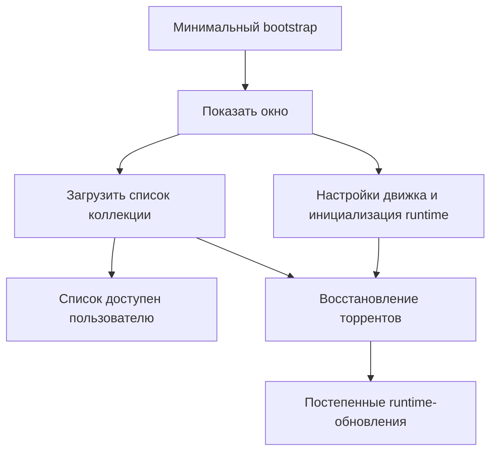

# Быстрый запуск, жизненный цикл и много окон

Дата: 2026-11-23. Контекст уточнён владельцем после первого анализа. Документ фиксирует пожелания и варианты для исследования. Он не является принятым ADR и не разрешает изменение кода.

Продолжение 2026-11-24: получены [первые измерения](STARTUP_BASELINE_2026-11-24.md). Владелец планирует .NET 11 и стабильные зависимости, включая WindowsAppSDK 2.7.0; уже заменил внутреннее восстановление движка собственным. Эти условия нужно сохранять при выборе следующих экспериментов.

## Что сообщил владелец

- Текущий запуск субъективно долгий; это одна из главных проблем разработки.
- Не удалось получить понятный и удобный порядок запуска и закрытия всех частей приложения.
- Асинхронность выбиралась ради быстрого запуска и сворачивания.
- Обсуждаются более быстрое хранение, упрощение получения пути с сохранением прежнего расположения данных, перенос части запуска в фон, изменение момента создания DI или самого контейнера.
- В будущем точно предполагается много окон.
- Модульный монолит рассматривается как вариант, но его целесообразность ещё не определена.

Пользователь не утверждал, что JSON, WinRT или DI уже доказанно являются причиной задержки. Замеры, целевые времена и условия запуска пока не получены. Последнее указание сохраняется: менять только документацию.

## Вывод из текущего кода

Главное направление исследования — состав работы до появления окна и владение жизненным циклом. Смена сериализатора и контейнера остаётся отдельными гипотезами. Ниже приведены конкретные пути кода; их вклад во время запуска нужно измерить.

### Окно ждёт ранние этапы

[AppLifecycleCoordinator](../../src/NiTorrent.Application/AppLifecycleCoordinator.cs) ожидает задачи последовательно. [TorrentEngineStartupTask](../../src/NiTorrent.Infrastructure/Torrents/TorrentEngineStartupTask.cs) выполняется на Core, [MainWindowLifecycleTask](../../src/NiTorrent.App/Services/AppLifecycle/MainWindowLifecycleTask.cs) — позже на Shell. Следовательно, время Core входит во время до показа окна.

`async` в объявлении метода не означает перенос работы с UI-потока. Например, [TorrentEngineCoordinator.InitializeAsync](../../src/NiTorrent.Infrastructure/Torrents/TorrentEngineCoordinator.cs) синхронно выполняет `new ClientEngine(...)` и возвращает `Task.CompletedTask`. На каком потоке реально выполняется каждый участок данного запуска, требуется установить трассировкой: ранние `await` могут завершаться синхронно.

Простая перестановка Shell перед Core недостаточна: [TorrentMetadataProvider](../../src/NiTorrent.Infrastructure/Torrents/TorrentMetadataProvider.cs) обращается к `coordinator.Engine` при создании адаптера. Создание view models может разрешить эту зависимость до готовности движка. Сначала нужно отделить возможность создать окно от необходимости иметь готовый runtime.

### Фактическая работа начинается раньше lifecycle-методов

[AppHostLifecycleService](../../src/NiTorrent.App/Services/AppLifecycle/AppHostLifecycleService.cs) зависит от координатора, а тот получает `IEnumerable<IAppLifecycleTask>` и материализует его в конструкторе. Поэтому при разрешении этого графа создаются задачи и их зависимости ещё до вызова их `StartAsync`.

В частности, фабрика `AppJsonSettings` в [DI](../../src/NiTorrent.Infrastructure/DI/DependencyInjection.cs) вызывает `JsonSettings.Load`, а конструктор [JsonTorrentRepository](../../src/NiTorrent.Infrastructure/Torrents/JsonTorrentRepository.cs) создаёт каталоги. Это стоимость разрешения графа объектов, которую нельзя приписывать чистой работе алгоритма DI-контейнера.

### По графу вызовов возможно два создания движка на запуске

В текущей регистрации прослеживается такая последовательность:

1. При создании lifecycle-задач создаётся `EngineSettingsService`, подписывающийся на `AppSettingsService.Changed`.
2. На Bootstrap `AppSettingsService.InitializeAsync` публикует `Changed`.
3. `OnUpdateSettings` вызывает `ApplySettingsAsync`; если движка ещё нет, `TorrentEngineCoordinator.ApplySettingsAsync` создаёт `ClientEngine`.
4. На Core `TorrentEngineLifecycle.StartAsync` вызывает `EngineSettingsService.InitializeAsync`, затем `TorrentEngineCoordinator.InitializeAsync`, который снова присваивает новый `ClientEngine`. Защита от повторной инициализации закомментирована.

Источники: [AppSettingsService](../../src/NiTorrent.Application/Settings/AppSettingsService.cs), [EngineSettingsService](../../src/NiTorrent.Infrastructure/Settings/EngineSettingsService.cs), [TorrentEngineCoordinator](../../src/NiTorrent.Infrastructure/Torrents/TorrentEngineCoordinator.cs). Это вывод по коду при успешном прохождении указанного пути, а не наблюдение из runtime-трассы. В первую очередь стоит подтвердить число созданий и судьбу предыдущего экземпляра. Последствия для сокетов и времени здесь не проверены.

### Запись диагностических логов сама выполняет I/O

[FileLogger.WriteLine](../../src/NiTorrent.App/Services/FileLogger.cs) синхронно ожидает `SemaphoreSlim`, создаёт каталог и дописывает файл для каждого сообщения. [EarlyLifecycleLogger](../../src/NiTorrent.App/Services/AppLifecycle/EarlyLifecycleLogger.cs) дополнительно создаёт `AppStorageService` и синхронно пишет файл на каждом вызове.

На обычном успешном пути [Program](../../src/NiTorrent.App/Program.cs) вызывает ранний логгер три раза до создания App. Кэширование путей в основном singleton не устраняет эти три отдельных создания. Проверять следует вместе получение пути, создание каталогов и запись, а не только `Path.Combine`.

## Разбор предложенных вариантов

| Вариант | Что может дать | Что нужно доказать перед выбором |
| --- | --- | --- |
| Бинарное хранение | Меньше работы с текстовым представлением; другой размер данных | Доля чтения/десериализации в задержке, размер коллекции, стоимость миграции |
| Отделить краткий список от metadata и всех файлов | Первый экран сможет читать только необходимые данные | Что каталог с подробными данными действительно влияет на первый экран |
| Упростить разрешение пути | Убрать повторное WinRT-разрешение и исключения на fallback-пути | Время первого и последующих обращений в packaged/unpackaged сборках; идентичность итогового пути |
| Отложить тяжёлые зависимости | Убрать их создание из пути до окна | Какие конструкторы и DI-фабрики делают I/O или требуют runtime |
| Другой контейнер | Возможное уменьшение собственной стоимости DI | Заметная стоимость именно контейнера после отделения конструкторов и I/O |
| BackgroundService для восстановления/мониторинга | Управляемая фоновая задача с остановкой и наблюдаемым результатом | Зависимости, готовность, ошибки и отмена; отсутствие обращения к UI с фонового потока |
| Модульный монолит | Более ясное владение функциональностью при росте приложения | Реальные зависимости между будущими функциями; не использовать как обещание ускорения старта |

### Какую библиотеку мог иметь в виду владелец

По описанию вероятный кандидат — [MemoryPack](https://github.com/Cysharp/MemoryPack), бинарный сериализатор с подходом zero encoding. Это предположение, название пользователь ещё не подтвердил. Другой кандидат для сравнения — [MessagePack for C#](https://github.com/MessagePack-CSharp/MessagePack-CSharp).

«Сохранить как есть» не означает записать в файл весь живой граф DI, движок и адреса управляемых объектов. У MemoryPack есть специальный путь для unmanaged-данных, а обычным объектам нужен известный контракт. Формат не самодостаточен: чтение требует схемы; изменение полей подчиняется правилам совместимости. Эти свойства описаны в [документации MemoryPack](https://github.com/Cysharp/MemoryPack#version-tolerant).

Для NiTorrent кандидат на сохранение — отдельная стабильная модель данных. Выбор MemoryPack сам по себе не решает частично записанный файл, миграцию версии и согласованность с runtime.

Текущий JSON уже использует source-generated `JsonSerializerContext`. При этом `TorrentBytes` хранится как Base64 внутри общего каталога: при чтении коллекции загружается и эта строка, даже если первому экрану нужны только название и статус. Сначала полезно сравнить состав читаемых данных, затем форматы на одинаковой модели. Бенчмарки библиотек не являются замером запуска NiTorrent.

### Получение пути с сохранением расположения

Сейчас [AppStorageService](../../src/NiTorrent.App/Services/AppStorageService.cs) разрешает корень в конструкторе и сохраняет его в `_localRoot`; `GetLocalPath` дальше делает только `Path.Combine`. Повторно исследовать путь при каждом вызове этого метода основной singleton не должен.

Кандидат для исследования — одно разрешение корня на процесс и использование результата также ранним логгером. Для packaged-варианта сохранить фактический LocalFolder; для fallback — текущий `%LOCALAPPDATA%/NiTorrent/LocalState`. Нельзя просто заменить оба режима одной строкой пути и считать место хранения сохранённым. Сравнивать нормализованные абсолютные пути до/после отдельно для каждого поддерживаемого режима.

### DI: разделить регистрацию, создание и запуск

Создание контейнера, разрешение объектов и запуск их работы — разные этапы. Обычные singleton-регистрации встроенного DI создаются при первом запросе, а не обязательно при регистрации: [Microsoft, service lifetimes](https://learn.microsoft.com/en-us/dotnet/core/extensions/dependency-injection/service-lifetimes).

Предлагаемая отправная точка: один контейнер на процесс, небольшие конструкторы, явный старт дорогой работы, отложенное создание функций, которые не нужны первому окну. Не строить контейнер заново на каждую страницу или окно. Для фабрик DI Microsoft также рекомендует быстрое синхронное выполнение: [guidelines](https://learn.microsoft.com/en-us/dotnet/core/extensions/dependency-injection/guidelines).

Если после этого профиль покажет существенную стоимость самого контейнера или default host configuration, сравнить альтернативы отдельным экспериментом. Сейчас доказательств необходимости замены контейнера нет.

## Предлагаемая модель запуска для обсуждения

Это вариант организации, а не утверждённая схема и не готовая замена текущих этапов:

Bootstrap должен подготовить то, без чего окно нельзя корректно создать: UI dispatcher, зависимости shell, нужные ему настройки темы/поведения и минимальную диагностику. Тяжёлые операции не должны попадать сюда через конструкторы.

Окно может быть доступно раньше полной готовности передачи. Готовность требуется различать: shell, коллекция, движок и конкретный торрент в runtime. Правило для команды до готовности конкретного торрента остаётся открытым Q-02: сохранить намерение либо временно запретить команду с понятным статусом.

Для фоновой работы подходит управляемая задача, например `BackgroundService`, но один тип не задаёт порядок зависимостей. В .NET 10 весь `ExecuteAsync` выполняется в фоне; пользовательские конструкторы и `StartAsync` от этого автоматически фоновыми не становятся: [изменение .NET 10](https://learn.microsoft.com/en-us/dotnet/core/compatibility/extensions/10.0/backgroundservice-executeasync-task).

У фоновой задачи должен быть владелец, сохранённый Task, отмена, обработка ошибки и ожидание завершения. Связь «движок готов → можно восстанавливать» должна быть явной. Не разбрасывать неотслеживаемые `Task.Run` по view models и не ожидать UI-готовность из того же пути, который ещё должен показать окно.

В [RestoreSessionUseCase](../../src/NiTorrent.Application/Torrents/UseCase/RestoreSessionUseCase.cs) восстановление сейчас последовательное и содержит `Task.Delay(5)` на запись. Это минимум запрошенных задержек порядка `N × 5 ms`, кроме I/O и runtime; не оценка реального времени. Конкурентность добавления следует выбирать только после проверки требований MonoTorrent и нагрузки на диск.

## Завершение и сворачивание

Скрытие окна в трей, закрытие одного окна и остановка процесса — три разных действия. Перенос движка в фон не означает, что его следует останавливать при сворачивании.

Сейчас [NiTorrentApplication.ShutdownAsync](../../src/NiTorrent.App/Services/AppLifecycle/NiTorrentApplication.cs) сначала ожидает завершения startup, затем запрещает новые активации и операции; скрытие shell выполняется после flush настроек. При медленном старте это может задержать реакцию на Exit. После таймаута startup ещё может продолжать работу: таймаут ожидания сам по себе её не отменяет.

Предлагаемые обязанности единого владельца lifecycle:

1. При Exit перевести приложение в Stopping, запретить новые действия и отменить оставшуюся работу startup/restore.
2. Быстро отразить выход в UI; точная политика скрытия всех окон требует Q-15.
3. Дождаться остановки производителей изменений, затем сохранить согласованное состояние. Для обязательного flush использовать отдельный ограниченный срок, а не уже отменённый startup-token.
4. Остановить runtime, подписки и прочую фоновую работу в порядке зависимостей; финальный runtime-flush разместить с учётом фактических требований движка.
5. Освободить ресурсы и окна, завершить host и UI loop. Чистое завершение отмечать только при реально выполненных обязательных шагах.

Сегодня `AppHostLifecycleService` тоже вызывает `StopAsync` координатора. Флаги защищают от повторного запуска отдельных шагов, но владение завершением распределено между несколькими путями. При переработке нужен один план завершения, который может запускаться из разных точек входа.

Частично успешный startup должен останавливаться по фактически созданным ресурсам. Общая отмена не должна приводить к параллельному изменению списка успешно запущенных задач и его перечислению при остановке. Отдельно проверить ошибку и таймаут: в текущем shutdown записывается clean marker и после некоторых перехваченных ошибок.

## Много окон и модульный монолит

Дополнение владельца 2026-11-24: будущий выбор движка — **один на всё приложение со сменой после перезапуска**. Одновременная работа нескольких backend не требуется. Предусмотреть выбор адаптера в composition root, явную готовность/ошибку подключения и сохранение переносимой коллекции отдельно от формата runtime конкретного движка. Вариант с внешним сервером имеет отдельные этапы подключения и согласования состояния; готовность UI не должна требовать запуска локального `ClientEngine`. Конкретная библиотека/сервер пока не выбраны. Текущий `ITorrentRuntimeGateway` — отправная точка, достаточность его interface для другого движка ещё не проверена.

Текущий проект уже представляет собой монолит с несколькими слоями. Деление по функциям — дополнительная ось организации: Torrents, Settings, Shell/Windows. Количество `.csproj` само по себе не создаёт полезных модулей.

Предложение для будущего роста: оставить общий runtime/коллекцию на процесс и отделить состояние конкретного окна. Модуль Torrents должен предоставлять небольшое interface управления и чтения, скрывающее порядок runtime/хранения; окно не должно знать детали этого порядка. Так увеличивается depth модуля, без обязательного добавления новых слоёв.

| Время жизни | Примеры обязанностей |
| --- | --- |
| Всё приложение | Движок, коллекция, настройки, lifecycle, приём активаций, реестр окон |
| Одно окно | Навигация, выбранный торрент, целевой XamlRoot для диалогов, view models, подписки и отмена загрузок окна |
| Одна операция | Preview, отдельная загрузка данных, ошибка/отмена конкретной команды |

Scope на окно можно создавать явно и освобождать после его закрытия. Встроенный DI не создаёт такие scopes сам. Закрытие окна прекращает его подписки, а не уничтожает общий движок.

В WinUI несколько окон могут работать на одном UI-потоке; отдельный поток и отдельный движок для каждого окна не требуются. Привязка диалогов к XamlRoot конкретного окна описана через модель окон в [Microsoft, multiple windows](https://learn.microsoft.com/en-us/windows/apps/develop/ui/multiple-windows).

Нужна политика для закрытия последнего окна и для восстановления из трея. Поэтому начинать разумно с владения окнами и lifecycle, а физическое перемещение всех файлов по новым модулям оставить до появления понятных функций. Наличие многих окон само по себе не доказывает необходимость полной реструктуризации.

## План измерений перед реализацией

Сейчас доступны временные отметки lifecycle; они не охватывают весь ранний запуск. Новое диагностическое изменение пока не выполнено.

| Метрика | Начало и конец |
| --- | --- |
| Время до видимого окна | От запуска процесса до реально отрисованного окна; `Activate()` не равен первому кадру |
| Время до списка | До первого показа сохранённой коллекции |
| Время до runtime | До готовности движка и отдельно до восстановления первого/последнего торрента |
| Время реакции на Exit/трей | От действия пользователя до видимой реакции окна |
| Время завершения процесса | От Exit до завершения процесса, отдельно от скрытия окна |

Разделить стоимость: WinRT/single-instance → разрешение storage → host Build → host Start и создание графа lifecycle → настройки/репозиторий → ClientEngine → XAML/окно/первый кадр → restore. Дополнительно посчитать создания движка, размеры каталога, объём Base64 и число файлов.

Для сравнения использовать установленную Release-версию без отладчика и отдельно Debug; одинаковую машину, сборку и данные. Холодный запуск после перезагрузки и повторные запуски отмечать раздельно. Начать с пустой, обычной и большой коллекции, фиксируя число торрентов/файлов. Несколько запусков и медиана/диапазон полезнее одного измерения. Числовой целевой бюджет пока не согласован.

Первые проверки: подтвердить число созданий ClientEngine; оценить время до Shell и чтение настроек при разрешении DI; измерить влияние синхронных логов; сравнить стоимость загрузки краткого списка и полного каталога. Затем выбрать одно изменение и повторить тот же сценарий. Назначать причиной DI или JSON до этих проверок оснований нет.
